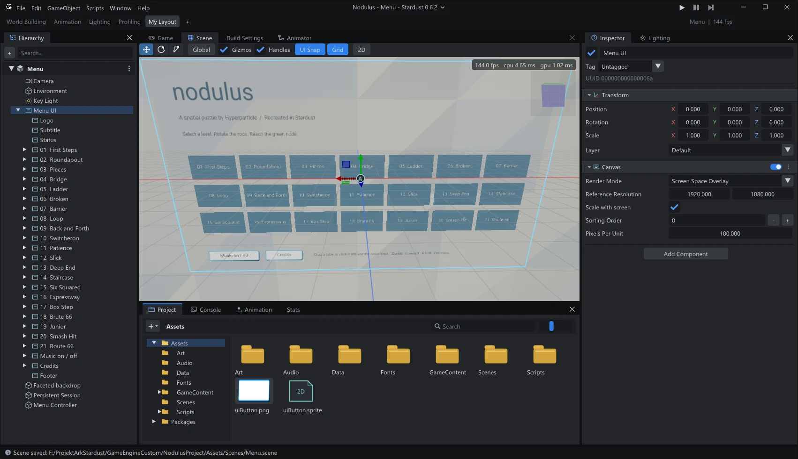

# Stardust Engine

A game engine written from scratch in C++20, with a Unity-like editor, C# scripting on .NET 8 and a bindless Vulkan 1.3 renderer.



## Highlights

- **Editor**: Hierarchy, Inspector, Project with a folder tree, Console with message details, Scene and Game views, Animation and Animator windows, Lighting, Build Settings and saved layouts.
- **Scripting**: C# components with Inspector fields, prefabs, scene loading, input axes, physics, UI, audio and editor-only scripts.
- **Rendering**: PBR materials, shadows, procedural sky and clouds, terrain with vegetation, water, post processing, LOD Groups, render textures and custom shaders.
- **Animation**: skinned FBX models, Animator controllers with transitions and 1D/2D blend trees.
- **Media**: audio through miniaudio, Video Player (MPEG-1 everywhere; MP4/MOV/WMV/AVI on Windows).
- **Builds**: standalone Player for Windows and Linux, assets packed in binary paks with optional encryption.

## Building

Requirements: CMake, a C++20 compiler (Visual Studio 2022 on Windows), the Vulkan SDK and the .NET 8 SDK. Dependencies are fetched by CMake.

```bash
cmake -S . -B build
cmake --build build --config Release --target StardustEditor
```

The editor is written to `build/bin/Release/StardustEditor.exe`. Close the editor before rebuilding: Windows locks the executable and `ScriptCore.dll`.

## Documentation

- [C# Scripting Guide](docs/CSHARP_SCRIPTING.md)
- [Rendering, input and editor API](docs/RENDERING_INPUT_EDITOR_API.md)
- [Custom shader properties](docs/CUSTOM_SHADER_PROPERTIES.md)
- [Engine architecture](docs/ARCHITECTURE.md)
- [Linux Player](docs/LINUX_PLAYER.md)
- [All documents](docs/README.md)
